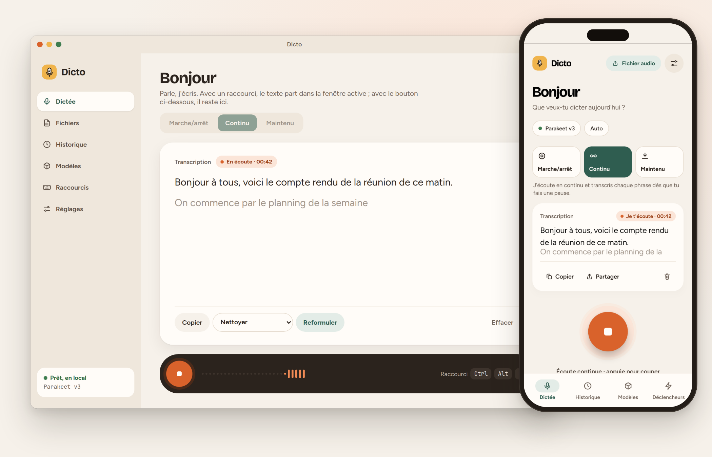
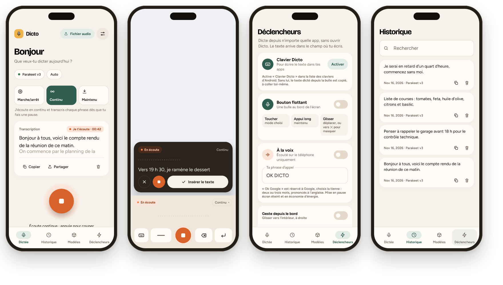
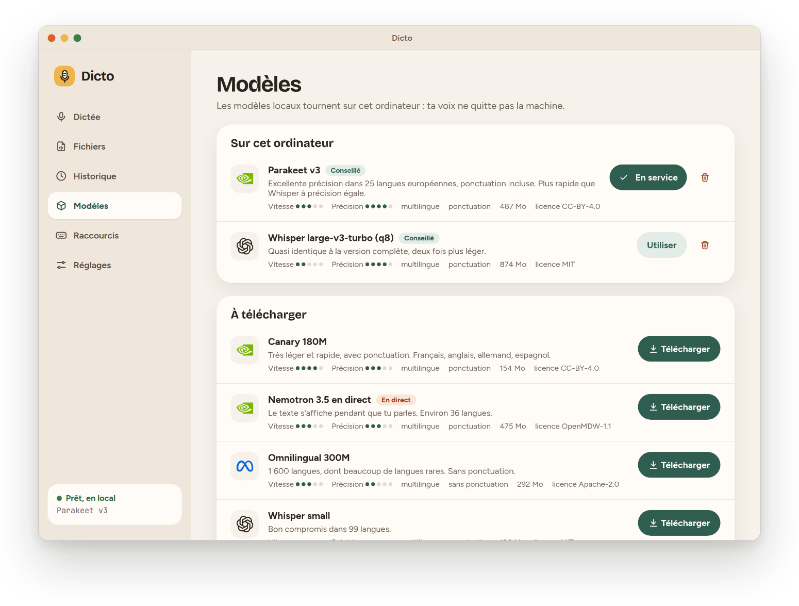
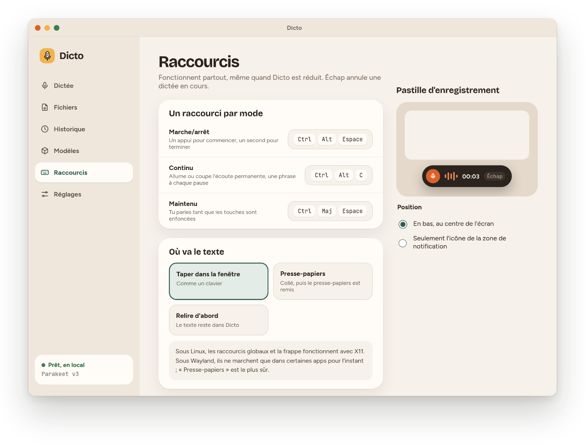

<p align="center">
  
</p>

<h1 align="center">Dicto</h1>

<p align="center">
  <b>La dictée, chez toi.</b><br>
  La reconnaissance vocale pour Android, Windows, Linux et macOS.<br>
  Des modèles qui tournent sur ta machine, ou le service en ligne de ton choix, avec ta propre clé.
</p>

<p align="center">
  <a href="https://github.com/MrDDream/Dicto/releases/latest"></a>
  <a href="https://github.com/MrDDream/Dicto/releases"></a>
  <a href="https://github.com/MrDDream/Dicto/actions/workflows/desktop.yml"></a>
  <br>
  
  
  
  
</p>

<p align="center">
  <a href="https://mrddream.github.io/Dicto/"><b>Site</b></a> ·
  <a href="https://github.com/MrDDream/Dicto/releases/latest"><b>Télécharger</b></a> ·
  <a href="https://apps.obtainium.imranr.dev/redirect?r=obtainium://add/https://github.com/MrDDream/Dicto">Avec Obtainium</a> ·
  <a href="README.md">English version</a>
</p>

<p align="center">
  
</p>

<p align="center">
  <a href="#%EF%B8%8F-pourquoi-dicto-">Pourquoi</a> ·
  <a href="#-ce-que-fait-dicto">Fonctions</a> ·
  <a href="#-sur-android">Android</a> ·
  <a href="#-sur-ton-ordinateur">Ordinateur</a> ·
  <a href="#-les-modèles">Modèles</a> ·
  <a href="#-installer">Installer</a> ·
  <a href="#-vie-privée">Vie privée</a> ·
  <a href="#%EF%B8%8F-compiler-soi-même">Compiler</a>
</p>

---

## 🎙️ Pourquoi Dicto ?

Écrire sur un téléphone est lent, et la plupart des outils de dictée envoient chaque mot prononcé sur les serveurs de quelqu'un d'autre. Dicto fait la reconnaissance vocale **sur ton appareil** : tu télécharges un modèle une fois, et ta voix ne quitte plus le téléphone ni l'ordinateur. Quand tu veux la meilleure précision sans charger le téléphone, branche le service en ligne que tu paies déjà (OpenAI, Mistral, Gemini, Grok, ou ton propre serveur Whisper), avec ta clé.

- **Sans compte, sans pub, sans traceur.** L'historique reste dans une base locale.
- **Un seul cœur Rust** pour toutes les plateformes : les mêmes moteurs, modes et commandes vocales partout.
- **Il écrit là où tu es** : le clavier Dicto et une bulle flottante sur Android, un raccourci global sur l'ordinateur.

## ✨ Ce que fait Dicto

| | |
| --- | --- |
| **Trois modes** | *Marche/arrêt* (un appui pour commencer, un pour finir), *Continu* (chaque phrase est écrite dès que tu marques une pause), *Maintenu* (talkie-walkie). |
| **Modèles locaux** | 13 modèles via whisper.cpp et sherpa-onnx : Whisper, Parakeet, Canary et Nemotron de NVIDIA, Omnilingual de Meta. Téléchargés une fois, vérifiés par SHA-256. |
| **Services en ligne** | OpenAI, Mistral (Voxtral), Google Gemini, Grok (xAI) ou n'importe quel serveur compatible OpenAI. La liste des modèles vient de chaque fournisseur. |
| **Texte en direct** | Avec les modèles en direct, la phrase s'affiche pendant que tu parles. |
| **Commandes vocales** | « Nouvelle ligne », « nouveau paragraphe », « efface ça », gérées par le cœur, sans LLM. |
| **Retouche par IA** | Nettoyage, mail, notes, ton formel, traduction ou ta propre consigne, avec Claude, OpenAI, Gemini, Ollama ou un serveur compatible OpenAI. Seul le texte est envoyé, jamais l'audio. |
| **Vocabulaire et profils** | Les noms et le jargon que le modèle doit connaître ; langue, retouche et mode selon l'app. |
| **Fichiers audio** | Transcris un message vocal ou un enregistrement (partagé depuis WhatsApp, Signal…), exporte en texte, Markdown, SRT ou WebVTT. |
| **Historique** | Toutes les dictées, avec recherche, dans une base SQLite sur l'appareil. |
| **Mises à jour** | Si tu l'acceptes, les apps regardent GitHub une fois par jour et n'installent une version que si sa somme de contrôle correspond. |

## 📱 Sur Android

<p align="center">
  
</p>

Dicte dans n'importe quelle app sans ouvrir Dicto :

- **Clavier Dicto** : passe dessus, parle, le texte s'écrit dans le champ ; ton clavier habituel peut revenir tout seul.
- **Bulle flottante** : touche pour dicter, appui long pour parler en maintenant, puis « Insérer le texte ». Le panneau se déplace.
- **Tuile des réglages rapides**, **geste depuis le bord**, mot d'activation **« OK Dicto »** (reconnu sur le téléphone par sherpa-onnx), et Dicto comme **application d'assistance**.
- **Partage un fichier audio** vers Dicto pour le transcrire.

## 💻 Sur ton ordinateur

<p align="center">
  
  
</p>

- **Un raccourci global par mode** (Ctrl+Alt+Espace, Ctrl+Alt+C, Ctrl+Maj+Espace par défaut), appuyé ou maintenu.
- Le texte est **tapé** dans la fenêtre active, **collé** (le presse-papiers est remis ensuite), ou **gardé dans Dicto** pour relecture.
- Une petite **pastille d'enregistrement** en bas de l'écran, une icône dans la **zone de notification** ; fermer la fenêtre laisse Dicto actif.
- Les clés des services restent dans le coffre du système (Gestionnaire d'identification, Trousseau, Secret Service), jamais en clair.

## 🧠 Les modèles

| Modèle | Moteur | Langues | Taille | Android | Bureau |
| --- | --- | --- | ---: | :---: | :---: |
| Canary 180M | sherpa-onnx | fr, en, de, es | 154 Mo | ✓ | ✓ |
| Parakeet v3 | sherpa-onnx | 25 langues européennes | 487 Mo | ✓ | ✓ |
| Nemotron 3.5 en direct | sherpa-onnx | ~36 langues | 475 Mo | ✓ | ✓ |
| Omnilingual 300M | sherpa-onnx | 1 600 langues | 292 Mo | ✓ | ✓ |
| Whisper tiny / base | whisper.cpp | 99 langues | 32 / 60 Mo | ✓ | |
| Whisper small | whisper.cpp | 99 langues | 190 Mo | ✓ | ✓ |
| Whisper large-v3-turbo (compact) | whisper.cpp | 99 langues | 574 Mo | ✓ | ✓ |
| Whisper medium | whisper.cpp | 99 langues | 539 Mo | | ✓ |
| Whisper large-v3-turbo (q8 / complet) | whisper.cpp | 99 langues | 874 Mo / 1,6 Go | | ✓ |
| Whisper français (distillé / complet) | whisper.cpp | Français | 791 Mo / 1,1 Go | | ✓ |

Le catalogue, avec adresses, licences et sommes de contrôle, est dans [core/catalog/models.json](core/catalog/models.json). Modèles de NVIDIA, Meta, OpenAI et Bofeng Huang, sous leurs propres licences (CC-BY-4.0, OpenMDW-1.1, Apache-2.0, MIT).

## 📦 Installer

Tout est dans la [dernière version](https://github.com/MrDDream/Dicto/releases/latest), avec `SHA256SUMS.txt` (Android) et `SHA256SUMS-desktop.txt` (bureau).

| Système | Fichier | À savoir |
| --- | --- | --- |
| Android 10+ | `Dicto-vX.Y.Z-arm64-v8a.apk` | L'universel `Dicto-vX.Y.Z.apk` en cas de doute. Paquet `app.dicto`. |
| Windows 10 / 11 | `Dicto-X.Y.Z-setup.exe` | Sans droits d'administrateur. Pas encore signé : SmartScreen › *Informations complémentaires* › *Exécuter quand même*. |
| Debian, Ubuntu | `dicto_X.Y.Z_amd64.deb` | |
| Fedora, openSUSE | `dicto-X.Y.Z.x86_64.rpm` | |
| Autres Linux | `Dicto-X.Y.Z-x86_64.AppImage` | Se met à jour d'elle-même. |
| macOS (puces Apple) | `Dicto-X.Y.Z-macos-arm64.dmg` | Pas encore notarisé : ouvre-le une fois, puis Réglages Système › Confidentialité et sécurité › *Ouvrir quand même*. |

Sur Android, [Obtainium](https://apps.obtainium.imranr.dev/redirect?r=obtainium://add/https://github.com/MrDDream/Dicto) peut suivre les versions pour toi.

## 🔒 Vie privée

- Avec un modèle local, **ni l'audio ni le texte ne quittent l'appareil**.
- Avec un service en ligne, l'audio va **seulement au fournisseur choisi**, avec **ta** clé. La retouche par IA n'envoie que le texte.
- Les clés sont gardées dans le Keystore d'Android ou le coffre de l'ordinateur.
- La vérification des mises à jour est **à ta demande** : une requête à GitHub par jour, rien d'autre. Une version n'est installée que si son SHA-256 correspond aux sommes publiées (et, sur Android, si elle est signée avec la même clé).

## 🛠️ Compiler soi-même

```
core/           cœur Rust partagé (dicto-core) et ses bindings UniFFI (dicto-ffi)
android/        app Kotlin / Jetpack Compose
desktop/        app Tauri 2 + Svelte 5
docs/           site (GitHub Pages), maquettes et captures
scripts/        environnement de compilation, bibliothèques Android, captures
```

**Cœur Rust**

```bash
cd core && cargo test
```

Les moteurs locaux sont des features Cargo : `whisper` (whisper.cpp, il faut `cmake` et libclang) et `sherpa` (sherpa-onnx, ses bibliothèques officielles sont téléchargées à la compilation). Sur le bureau, avec whisper dans le même binaire, utiliser `sherpa-shared`.

**Android** : les outils sont pris dans `~/android-tools` (JDK 21, SDK, NDK 29), ou dans `ANDROID_TOOLS`, `JAVA_HOME`, `ANDROID_HOME`, `ANDROID_NDK_HOME`.

```bash
scripts/build-android-libs.sh        # cœur Rust + moteurs → jniLibs, classes Kotlin
source scripts/env.sh && cd android && ./gradlew :app:assembleDebug
```

**Bureau** : Node 22 et Rust stable ; sous Linux, les paquets de développement WebKitGTK, appindicator, ALSA et libxdo.

```bash
cd desktop && npm ci && npx tauri dev
```

**Captures et maquettes** (`docs/assets/`) : `scripts/screenshots.sh` rend les vrais écrans Android avec Robolectric et l'interface du bureau dans Chromium, puis les met en scène.

**Versions** : pousser un tag `vX.Y.Z` compile les APK signés et les paquets du bureau sur GitHub Actions et les publie avec leurs sommes de contrôle ([release.yml](.github/workflows/release.yml)).

## 🙏 Crédits

Dicto s'appuie sur [whisper.cpp](https://github.com/ggml-org/whisper.cpp), [sherpa-onnx](https://github.com/k2-fsa/sherpa-onnx), [UniFFI](https://github.com/mozilla/uniffi-rs), [Tauri](https://tauri.app) et [Svelte](https://svelte.dev), et sur les modèles publiés par NVIDIA, Meta, OpenAI et Bofeng Huang. Polices : Bricolage Grotesque, Figtree et JetBrains Mono.
