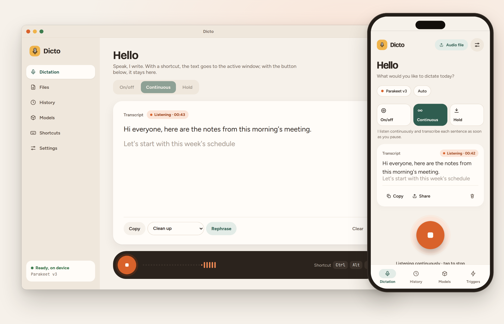
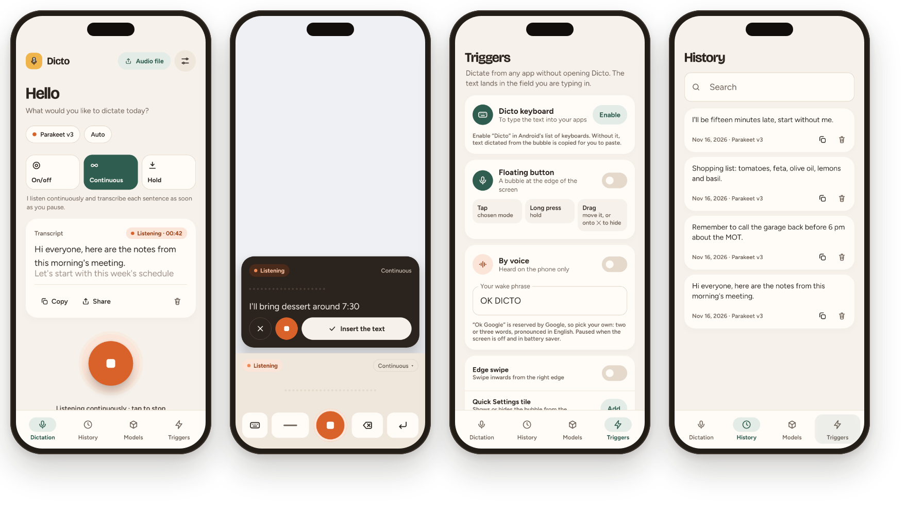
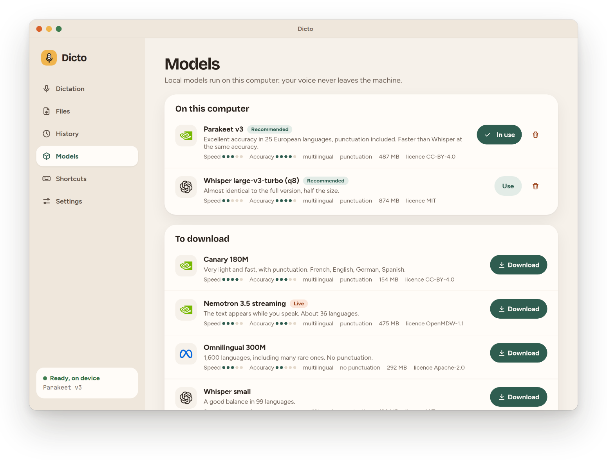
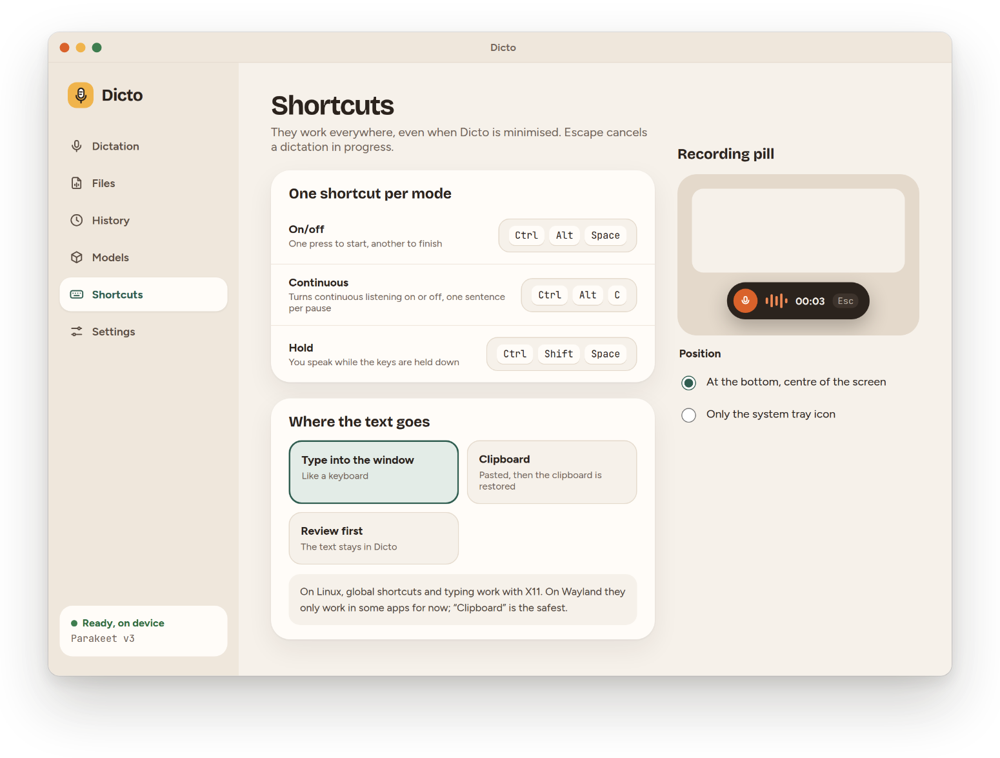

<p align="center">
  
</p>

<h1 align="center">Dicto</h1>

<p align="center">
  <b>Dictation that stays with you.</b><br>
  Speech to text for Android, Windows, Linux and macOS.<br>
  Models that run on your device, or the online service of your choice, with your own key.
</p>

<p align="center">
  <a href="https://github.com/MrDDream/Dicto/releases/latest"></a>
  <a href="https://github.com/MrDDream/Dicto/releases"></a>
  <a href="https://github.com/MrDDream/Dicto/actions/workflows/desktop.yml"></a>
  <a href="LICENSE"></a>
  <br>
  
  
  
  
</p>

<p align="center">
  <a href="https://mrddream.github.io/Dicto/"><b>Website</b></a> ·
  <a href="https://github.com/MrDDream/Dicto/releases/latest"><b>Download</b></a> ·
  <a href="https://apps.obtainium.imranr.dev/redirect?r=obtainium://add/https://github.com/MrDDream/Dicto">Get it with Obtainium</a> ·
  <a href="README.fr.md">Version française</a>
</p>

<p align="center">
  
</p>

<p align="center">
  <a href="#%EF%B8%8F-why-dicto">Why</a> ·
  <a href="#-what-it-does">Features</a> ·
  <a href="#-on-android">Android</a> ·
  <a href="#-on-your-computer">Desktop</a> ·
  <a href="#-models">Models</a> ·
  <a href="#-install">Install</a> ·
  <a href="#-privacy">Privacy</a> ·
  <a href="#%EF%B8%8F-build-from-source">Build</a>
</p>

---

## 🎙️ Why Dicto?

Typing on a phone is slow, and most dictation tools send every word you say to someone else's servers. Dicto runs the speech recognition **on your device**: download a model once, and your voice never leaves the phone or the computer. When you want the best accuracy without loading the phone, plug in the online service you already pay for (OpenAI, Mistral, Gemini, Grok, or your own Whisper server), with your own key.

- **Free and open source** (GPL-3.0), no account, no ads, no tracker. Your history stays in a local database.
- **One Rust core** for every platform: the same engines, modes and voice commands everywhere.
- **It writes where you are**: the Dicto keyboard and a floating bubble on Android, a global shortcut on the desktop.

- **In English and French**, with a light and a dark theme that can follow your device.

## ✨ What it does

| | |
| --- | --- |
| **Three modes** | *On / off* (one press to start, another to stop), *Continuous* (each sentence is written as soon as you pause), *Hold* (walkie-talkie). |
| **Local models** | 13 models through whisper.cpp and sherpa-onnx: Whisper, NVIDIA Parakeet, Canary and Nemotron, Meta Omnilingual. Downloaded once, checked by SHA-256. |
| **Online services** | OpenAI, Mistral (Voxtral), Google Gemini, Grok (xAI) or any OpenAI-compatible server. The model list comes from each provider. |
| **Live text** | With the streaming models, the sentence appears while you speak. |
| **Voice commands** | “New line”, “new paragraph”, “delete that”, handled by the core without any LLM. |
| **AI touch-up** | Clean-up, e-mail, notes, formal tone, translation or your own instruction, with Claude, OpenAI, Gemini, Ollama or an OpenAI-compatible server. Only the text is sent, never the audio. |
| **Vocabulary and profiles** | Names and jargon the model should know; language, touch-up and mode per app. |
| **Audio files** | Transcribe a voice message or a recording (shared from WhatsApp, Signal…), export to text, Markdown, SRT or WebVTT. |
| **History** | Every dictation, searchable, in a SQLite database on the device. |
| **Updates** | If you agree, the apps check GitHub once a day and install a new version only when its checksum matches. |

## 📱 On Android

<p align="center">
  
</p>

Dictate into any app without opening Dicto:

- **Dicto keyboard**: switch to it, speak, and the text is typed into the field; your usual keyboard can come back by itself.
- **Floating bubble**: tap to dictate, long-press to talk while holding, then “Insert the text”. The panel can be dragged.
- **Quick-settings tile**, **edge swipe**, **“OK Dicto”** wake word (spotted on the phone by sherpa-onnx), and Dicto as the **assistant app**.
- **Share an audio file** to Dicto to transcribe it.

## 💻 On your computer

<p align="center">
  
  
</p>

- **One global shortcut per mode** (Ctrl+Alt+Space, Ctrl+Alt+C, Ctrl+Shift+Space by default), held or pressed.
- The text is **typed** into the active window, **pasted** (your clipboard is put back afterwards), or **kept in Dicto** to review.
- A small **recording pill** at the bottom of the screen, an icon in the **system tray**; closing the window keeps Dicto running.
- Online keys live in the system's keystore (Credential Manager, Keychain, Secret Service), never in plain text.

## 🧠 Models

| Model | Engine | Languages | Size | Android | Desktop |
| --- | --- | --- | ---: | :---: | :---: |
| Canary 180M | sherpa-onnx | fr, en, de, es | 154 MB | ✓ | ✓ |
| Parakeet v3 | sherpa-onnx | 25 European languages | 487 MB | ✓ | ✓ |
| Nemotron 3.5 streaming | sherpa-onnx | ~36 languages | 475 MB | ✓ | ✓ |
| Omnilingual 300M | sherpa-onnx | 1,600 languages | 292 MB | ✓ | ✓ |
| Whisper tiny / base | whisper.cpp | 99 languages | 32 / 60 MB | ✓ | |
| Whisper small | whisper.cpp | 99 languages | 190 MB | ✓ | ✓ |
| Whisper large-v3-turbo (compact) | whisper.cpp | 99 languages | 574 MB | ✓ | ✓ |
| Whisper medium | whisper.cpp | 99 languages | 539 MB | | ✓ |
| Whisper large-v3-turbo (q8 / full) | whisper.cpp | 99 languages | 874 MB / 1.6 GB | | ✓ |
| Whisper French (distilled / full) | whisper.cpp | French | 791 MB / 1.1 GB | | ✓ |

The catalogue, with URLs, licences and checksums, is [core/catalog/models.json](core/catalog/models.json). Models by NVIDIA, Meta, OpenAI and Bofeng Huang, under their own licences (CC-BY-4.0, OpenMDW-1.1, Apache-2.0, MIT).

## 📦 Install

Everything is on the [latest release](https://github.com/MrDDream/Dicto/releases/latest), with `SHA256SUMS.txt` (Android) and `SHA256SUMS-desktop.txt` (desktop).

| System | File | Notes |
| --- | --- | --- |
| Android 10+ | `Dicto-vX.Y.Z-arm64-v8a.apk` | The universal `Dicto-vX.Y.Z.apk` if unsure. Package `app.dicto`. |
| Windows 10 / 11 | `Dicto-X.Y.Z-setup.exe` | No administrator rights needed. Not signed yet: SmartScreen › *More info* › *Run anyway*. |
| Debian, Ubuntu | `dicto_X.Y.Z_amd64.deb` | |
| Fedora, openSUSE | `dicto-X.Y.Z.x86_64.rpm` | |
| Other Linux | `Dicto-X.Y.Z-x86_64.AppImage` | Updates itself in place. |
| macOS (Apple silicon) | `Dicto-X.Y.Z-macos-arm64.dmg` | Not notarised yet: open it once, then System Settings › Privacy & Security › *Open Anyway*. |

On Android, [Obtainium](https://apps.obtainium.imranr.dev/redirect?r=obtainium://add/https://github.com/MrDDream/Dicto) can follow the releases for you.

## 🔒 Privacy

- With a local model, **no audio and no text leaves the device**.
- With an online service, the audio goes **only to the provider you picked**, with **your** key. AI touch-up sends the text only.
- Keys are kept in the Android Keystore or the computer's keystore.
- The update check is **opt-in**: one request to GitHub a day, nothing else. A new version is installed only if its SHA-256 matches the release's checksums (and, on Android, if it is signed with the same key).

## 🛠️ Build from source

```
core/           shared Rust core (dicto-core) and its UniFFI bindings (dicto-ffi)
android/        Kotlin / Jetpack Compose app
desktop/        Tauri 2 + Svelte 5 app
docs/           website (GitHub Pages), mockups and screenshots
scripts/        build environment, Android native libraries, screenshots
```

**Rust core**

```bash
cd core && cargo test
```

Local engines are Cargo features: `whisper` (whisper.cpp, needs `cmake` and libclang) and `sherpa` (sherpa-onnx, its official libraries are downloaded at build time). On the desktop, with whisper in the same binary, use `sherpa-shared`.

**Android**: the tools are read from `~/android-tools` (JDK 21, SDK, NDK 29), or from `ANDROID_TOOLS`, `JAVA_HOME`, `ANDROID_HOME`, `ANDROID_NDK_HOME`.

```bash
scripts/build-android-libs.sh        # Rust core + engines → jniLibs, Kotlin bindings
source scripts/env.sh && cd android && ./gradlew :app:assembleDebug
```

**Desktop**: Node 22 and Rust stable; on Linux, the WebKitGTK, appindicator, ALSA and libxdo development packages.

```bash
cd desktop && npm ci && npx tauri dev
```

**Screenshots and mockups** (`docs/assets/`): `scripts/screenshots.sh` renders the real Android screens with Robolectric and the desktop interface in Chromium, then frames them.

**Releases**: pushing a tag `vX.Y.Z` builds the signed APKs and the desktop packages on GitHub Actions and publishes them with their checksums ([release.yml](.github/workflows/release.yml)).

## 🙏 Credits and licence

Dicto is free software under the [GNU GPL v3](LICENSE). It stands on [whisper.cpp](https://github.com/ggml-org/whisper.cpp), [sherpa-onnx](https://github.com/k2-fsa/sherpa-onnx), [UniFFI](https://github.com/mozilla/uniffi-rs), [Tauri](https://tauri.app) and [Svelte](https://svelte.dev), and on the models published by NVIDIA, Meta, OpenAI and Bofeng Huang. Design: Bricolage Grotesque, Figtree and JetBrains Mono.
